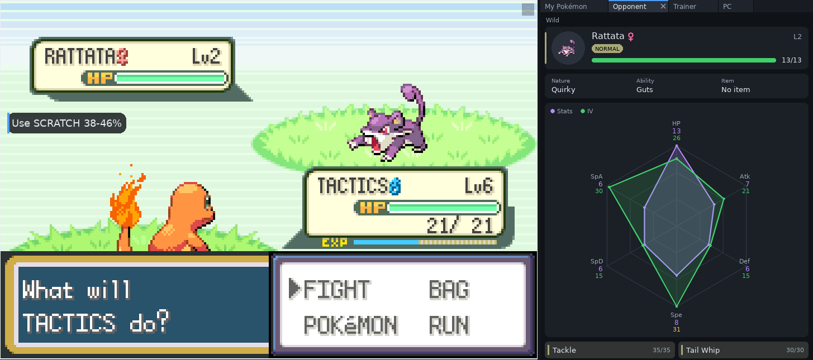
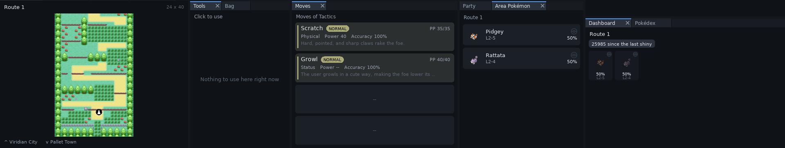

# Trainer Lens

Information panels for Pokémon FireRed/LeafGreen on Gen1Recomp (mod API 3). With Trainer Desk installed, every panel sits in a dock around the game and redraws itself for the room it has; without it, up to five panels open as desktop windows.





Panels read the game. The only ones that change anything do so when you click, through the game's own functions: the Tools panel uses field moves and key items (and Auto Repel uses a Repel when one wears off), the Party panel swaps two members and gives or takes held items, and the PC panel moves Pokémon between box slots and sorts the boxes you have not locked.

## Panels

| Panel | What it shows |
| --- | --- |
| Dashboard | One panel that follows you: while exploring, the area's Pokémon (caught or not, chance, levels), the Repel steps, VS Seeker charge, a waiting egg, encounters since the last shiny and the items left; in a battle, the opponent, and in a wild battle the exact catch chance of each ball you carry. |
| Area Pokémon | Wild Pokémon of the current map by method (grass, Surf, rods, rocks), level range and chance; caught species marked with a Poké Ball. Click a species for its sheet. |
| Party | HP, level, gender, status and held item. Click one member, then another, to swap them. Click the held item (or the picture, on small cards) to give, take or switch items from the bag. |
| Opponent | The opponent's full sheet in battle: types, nature, ability, item, a radar chart of stats and IVs, moves. |
| My Pokémon | The same sheet for your Pokémon, with EVs: the summary screen's Pokémon, the PC cursor's, the party menu's, the one in battle, or the party lead. |
| Moves | Your Pokémon's moves with type, category, power, accuracy, PP, description, and effectiveness against the opponent in battle. |
| Item radar | Visible and hidden items left on the map, nearest first. |
| Tools | One click for the bicycle, field moves (Cut, Surf, Strength, Flash, Rock Smash, Waterfall, Dig, Teleport, Sweet Scent), rods, VS Seeker, Repels and Escape Rope. Only what can be used right now is shown. Auto Repel toggle. |
| Trainer | Name, ID, money, play time, the eight badges, Pokédex counts and save counters. |
| Progress | How many of each area's wild species are caught. |
| Area map | The current map drawn with the game's own tiles, with you, trainers, other characters and items. |
| Region map | The game's Town Map with your position. |
| Pokédex | Every species in a grid; click one for its sheet (base stats, abilities, evolutions, where to find it). |
| Bag | The five pockets, with item icons and descriptions. View only. |
| Day-Care | The Four Island and Route 5 Day-Care boarders, their levels if taken back now, the cost, and a waiting egg. |
| Counter | Wild encounters by species, encounters since the last shiny, and shinies seen. |
| Notices | A short feed: a wild shiny, the VS Seeker charged, a Repel wearing off, a fainted party member, Day-Care news, and Trainer Pilot stopping. |
| PC | The PC boxes as a grid; click a Pokémon for its full sheet. Move Pokémon between slots and boxes (drag, or Move). Lock boxes and sort the others: living dex with gaps for missing species (repeats side by side or at the end), species then level, level up or down, or just remove gaps, with one step of undo. Slots show the Pokédex number. Nothing is ever deposited or withdrawn: the party is never touched. |

See [docs/PANELS.md](docs/PANELS.md) for where each panel reads its data.

## Compatibility

| | |
| --- | --- |
| Games | FireRed and LeafGreen |
| Gen1Recomp | 0.3.93 or newer (mod API 3); tested on 0.4.8 |

## Installation

Copy the `trainer_lens` folder into the game's mods folder:

```
%APPDATA%\pokemon-love2d\mods\trainer_lens
```

Trainer Desk is optional but recommended.

## Options

| Option | Default | What it does |
| --- | --- | --- |
| Panel placement | IDE (Trainer Desk) | Dock the panels in Trainer Desk, or open them as desktop windows. Without Trainer Desk, windows are used. |
| Panel windows | 3 | How many desktop windows to open in window mode (0 to 5). |
| Panel 1 to 5 | area, party, opponent, radar, my Pokémon | Which panel each desktop window shows. |
| Opponent in battle | on | In window mode, panel 1 shows the opponent during a battle unless another window already does. |
| Language | English | Language of the panels: ENGLISH, ESPANOL, PORTUGUES or JAPANESE. |
| Remember windows | on | Windows only: put the panel windows back where you left them. |
| Remember game window | on | Windows only: also remember the main game window. |
| Bring windows forward | on | Windows only: when the game gains focus, bring its other windows forward too. |

## Languages

The panel text is in English, Spanish, Portuguese and Japanese: choose one with the **Language** option in the mod's settings. Names that come from the game itself (Pokémon, moves, items, places) stay in the language of your game.

Each language is a file in `trainer_lens/lang/` (`en.lua`, `es.lua`, `pt.lua`, `ja.lua`); English is the reference, and a text missing from another language shows in English. Japanese text is drawn with a cut-down copy of Noto Sans JP in `trainer_lens/fonts/` (SIL Open Font License, `fonts/OFL.txt`). See [docs/TRANSLATING.md](docs/TRANSLATING.md) to fix or add a translation.

## Documentation

- [docs/GUIDE.md](docs/GUIDE.md): player guide, every panel and setting.
- [docs/PANELS.md](docs/PANELS.md): each panel and the game data behind it.
- [docs/ARCHITECTURE.md](docs/ARCHITECTURE.md): how the files fit together, hooks and saved data.
- [docs/TRANSLATING.md](docs/TRANSLATING.md): how the translations work and how to change them.
- [docs/PUBLISHING.md](docs/PUBLISHING.md): releases and the Gen1Recomp mod index.
- [CHANGELOG.md](CHANGELOG.md): version history.
- [tests/README.md](tests/README.md): running the automated checks.

## History

Until version 2.8.0 this mod was called PokePanels (id `poke_panels`).

## What it changes in the game

[DIFFERENCES.md](DIFFERENCES.md) lists everything this mod does differently from the unmodded game.

## License

MIT (see LICENSE). The bundled Japanese font is under the SIL Open Font License (`fonts/OFL.txt`).
